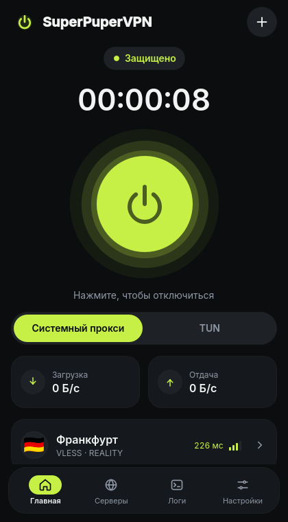
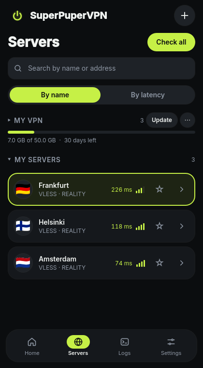
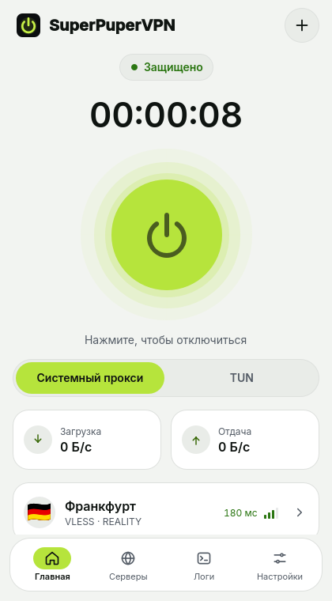
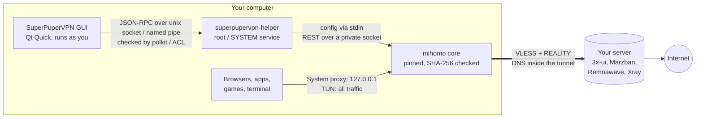

<p align="center">
  
</p>

<h1 align="center">SuperPuperVPN</h1>

<p align="center">
  <b>One button. Your own VLESS + REALITY servers. Windows and Linux.</b><br>
  A clean desktop client that turns a <code>vless://</code> link into a working connection in seconds.
</p>

<p align="center">
  <a href="https://github.com/NikitaKnutov/superpupervpn/releases/latest"></a>
  <a href="https://github.com/NikitaKnutov/superpupervpn/actions/workflows/build.yml"></a>
  
  <a href="LICENSE"></a>
</p>

<p align="center">
  
  &nbsp;
  
  &nbsp;
  
</p>

---

## Why

Most VLESS clients are built for people who already know what `spx`, `sid` and `fp` mean, and many of them
open an unauthenticated local SOCKS port that any program on your computer can use to leak your real IP.

SuperPuperVPN is the opposite:

- **Paste a link, press the button.** Nothing else to configure.
- **Secure by default.** No open ports in TUN mode, an authenticated privileged helper, encrypted profiles.
- **Built for your own servers** (3x-ui, Marzban, Remnawave or a hand-written Xray config) and for the people
  you share them with.

## Features

- **Import** from the clipboard (`Ctrl+V`): one link, many links or a base64 blob; or by subscription URL with
  traffic and expiry shown from the `subscription-userinfo` header. `vless://` and `superpupervpn://` deep links.
- **Two modes**
  - **System proxy**: browsers and apps that respect the OS proxy go through the server.
  - **TUN**: all traffic of the computer goes through the server, including games and the terminal.
- **All traffic through the tunnel**, DNS included (DoH through the connection, fake-IP in TUN), IPv6 never leaks.
- **Server list** with search, sorting, pinning, real latency (`generate_204` through the server itself)
  and **country flags detected from the server IP** with an offline database.
- **Honest status**: "Connected" only after a real request went through the server.
- **Auto-recovery**: the core is restarted if it crashes; the system proxy is restored after a crash or a power loss.
- **Dark and light themes**, tray icon, autostart, connect on start, a log viewer with masked export.
- **No telemetry.** Ever.

## Install

Grab the latest build from **[Releases](https://github.com/NikitaKnutov/superpupervpn/releases/latest)**.

### Windows 10 / 11 (x64)

1. Download `SuperPuperVPN-<version>-windows-x64.msi`.
2. Run it. Windows asks for administrator rights once: the installer sets up the *SuperPuperVPN Helper*
   service that TUN mode needs.
3. Start **SuperPuperVPN** from the Start menu.

The builds are not code-signed yet, so SmartScreen may warn you: choose *More info → Run anyway*.
Smart App Control (Windows 11) has no such button: while it is on, it blocks unsigned apps, and SuperPuperVPN
cannot start until the builds are signed.
A portable `.zip` is attached as well; in that case run `superpupervpn-helper.exe` as administrator yourself.

> Windows support is new. If something does not work, please open an issue with the log export
> (*Logs → Export*, «Логи» → «Экспорт» in the app).

### Fedora Linux 42 or newer (x86_64)

One RPM fits every supported Fedora release, so the `fc43` in its name is expected on Fedora 44 and 45 too.

```bash
sudo dnf install ./superpupervpn-*.x86_64.rpm
```

The package installs and starts the `superpupervpn-helper` system service. Launch **SuperPuperVPN** from the
app grid or run `superpupervpn`.

On GNOME the tray icon needs the
[AppIndicator extension](https://extensions.gnome.org/extension/615/appindicator-support/)
(`gnome-shell-extension-appindicator`); without it the app works fine and asks what to do when you close the window.

Uninstall: `sudo dnf remove superpupervpn`.

### Ubuntu 22.04, Debian 12, Linux Mint 21 or newer (amd64)

```bash
sudo apt install ./superpupervpn_*_amd64.deb
```

These distros ship Qt older than the 6.8 the app needs, so the package carries its own Qt in
`/usr/lib/superpupervpn`; the system Qt is not touched. Like the RPM, it installs and starts the helper service.
Uninstall: `sudo apt remove superpupervpn`.

Other distributions: build from source (see below).

## Quick start

The interface is in Russian for now (an English translation is very welcome, see [Contributing](#contributing)),
so button names are given below as **English** («Русский»).

1. Copy your `vless://...` link (or a subscription URL).
2. Open SuperPuperVPN and press **`Ctrl+V`** (or the **+** button) → **Add** («Добавить»).
3. Pick **System proxy** («Системный прокси») or **TUN** and press the big button.

Tap a server in **Servers** («Серверы») to select it; **Check all** («Проверить все») measures the latency of every server.

## How it works



The GUI has no privileges and never talks to the core directly; the core only ever runs a config that the
helper generated and validated itself.

- The **GUI** never touches the core. It stores profiles in `profiles.enc` (AES-256-GCM, key in the OS keyring:
  libsecret on Linux, DPAPI on Windows) and sends a structured profile to the helper.
- The **helper** re-validates every field, generates the core config from a whitelist, starts the pinned
  [mihomo](https://github.com/MetaCubeX/mihomo) binary after checking its SHA-256 and passes the config through
  stdin, so it never touches the disk.
- The core API is reachable only through a socket in a `0700` directory (Linux) or a SYSTEM-only named pipe
  (Windows). No TCP ports. In TUN mode nothing listens on localhost at all; in proxy mode exactly one TCP port on
  `127.0.0.1` is open.
- Access to the helper: on Linux every connection is checked with polkit (active local session only), on Windows
  the pipe is limited to SYSTEM and interactive users and refuses network clients.

### Supported links

`vless://` with `security=reality|tls|none`, `flow=xtls-rprx-vision`, transports `tcp`, `ws`, `httpupgrade`,
`grpc`, `xhttp`, `http` (h2), ML-KEM `encryption`, `alpn`, `ech`, certificate pinning (`pcs`).
Links with parameters the core cannot honour (`pqv`, `fm`, `spx` other than `/`, `type=kcp`, `vcn`) are refused
with a clear message instead of connecting half-way. Other schemes (vmess, trojan, ss, ...) are recognised and
reported as unsupported.

## Troubleshooting

| Symptom | What to do |
|---|---|
| "Service is not running" («Служба не запущена») | *Settings → Service → Start* («Настройки» → «Служба» → «Запустить»), or `sudo systemctl start superpupervpn-helper` |
| "Server does not respond" («сервер не отвечает») | The server refused the handshake or is unreachable. Commercial subscriptions often have dead nodes: **Check all** («Проверить все») in **Servers** shows which ones answer. For your own server, check the link with another client or get a fresh one from your panel. |
| TUN connects but nothing loads | Another VPN is running and takes the traffic. The app lists it before connecting and in *Diagnostics* («Диагностика»); press *Turn off other VPNs* («Выключить другие VPN»), or use proxy mode, which works next to other VPNs. |
| No tray icon on GNOME | Install and enable the AppIndicator extension. |
| Proxy mode does not work in a terminal | CLI tools ignore the desktop proxy setting; use TUN mode. |

## Build from source

Requirements: CMake ≥ 3.21, a C++20 compiler, Qt ≥ 6.8 (Base, Declarative, Network), OpenSSL 3,
libsecret (Linux).

```bash
sudo dnf install cmake ninja-build gcc-c++ qt6-qtbase-devel qt6-qtdeclarative-devel openssl-devel libsecret-devel
cmake -S . -B build -G Ninja -DCMAKE_BUILD_TYPE=RelWithDebInfo
cmake --build build
ctest --test-dir build
```

Release builds pass `-DSUPERPUPERVPN_CORE_SHA256=<sha256 of the mihomo binary>`; without it the helper refuses
to start the core. The pinned core and its hashes live in [`core.lock`](core.lock).

Packages:

- **RPM**: put the source tarball and the core archive from `core.lock` into `~/rpmbuild/SOURCES`
  (`spectool -g packaging/linux/superpupervpn.spec`) and run `rpmbuild -bb packaging/linux/superpupervpn.spec`.
- **DEB**: on Ubuntu 22.04, install Qt 6.8 with [aqtinstall](https://github.com/miurahr/aqtinstall) and point
  `CMAKE_PREFIX_PATH` at it, `cp -r packaging/debian debian`, put the core archive from `core.lock` next to the
  sources and run `dpkg-buildpackage -b -us -uc` (the `deb` job does exactly this). `-DSUPERPUPERVPN_BUNDLE_QT=ON`
  is what copies that Qt into the package.
- **MSI / ZIP**: built by the `windows` job in [`.github/workflows/build.yml`](.github/workflows/build.yml).

### Developer mode

`-DSUPERPUPERVPN_DEV=ON` lets both binaries run unprivileged from a scratch directory (never use it for packages):

- helper: `SUPERPUPERVPN_SOCKET`, `SUPERPUPERVPN_RUN_DIR`, `SUPERPUPERVPN_DATA_DIR`, `SUPERPUPERVPN_CORE_PATH`,
  `SUPERPUPERVPN_POLKIT_ACTION`; an unpinned core is allowed;
- GUI: `SUPERPUPERVPN_SOCKET`; `SUPERPUPERVPN_GRAB=out.png QT_QPA_PLATFORM=offscreen` renders one frame and exits.

`SUPERPUPERVPN_TEST_MIHOMO=/path/to/mihomo ctest` additionally validates every generated config with `mihomo -t`.

### Project layout

```
src/core     link parser, validation, subscriptions, core config generator, masking, GeoIP (no I/O)
src/helper   privileged service: JSON-RPC server, core process manager, platform layer
src/gui      Qt Quick app: storage, system proxy, tray, QML screens
tests        unit tests (link vectors, config security checks, theme contrast, translations)
packaging    systemd unit, polkit action, .desktop, RPM spec, Debian packaging, WiX installer
tools        make-geo.py: rebuilds assets/geo/country.bin from the DB-IP Lite CSV
licenses     third-party license texts shipped with the packages
```

## Contributing

Pull requests are welcome. The most useful things right now:

- **An English UI.** The QML screens already wrap their strings in `qsTr()`; some messages in the C++ code
  still need to be marked for translation.
- **Testing on other distributions** and on Windows, with a log export attached to the issue.

Run `ctest --test-dir build` before sending a PR. By contributing you agree that your code is released under
the project's license (GPL-3.0-or-later).

## Feedback

- **Bugs and ideas**: [Issues](https://github.com/NikitaKnutov/superpupervpn/issues). The templates ask for the
  version, the OS and an exported log (*Logs → Export*, «Логи» → «Экспорт»; personal data is masked).
- **Questions and discussions**: [Discussions](https://github.com/NikitaKnutov/superpupervpn/discussions).
- **Vulnerabilities**: privately only, see [SECURITY.md](SECURITY.md).

## Support the project

SuperPuperVPN is a free, non-commercial client built by one person. No built-in servers, no ads,
no telemetry — donations are what keeps the development going.

**USDT (TRC-20)** — network fee is a few cents:

```
TK8VdDvtU7Mq5b7X59SfpdURfpZR9etFmu
```


Donations fund client development only; VPN servers and subscriptions are not included.

## License

SuperPuperVPN is free software: © Nikita Knutov, licensed under the
[GNU General Public License v3.0 or later](LICENSE). You may use, study, share and modify it; if you distribute
a modified version, it has to stay open source under the same license.

It ships third-party components under their own licenses, see [`licenses/`](licenses):
[mihomo](https://github.com/MetaCubeX/mihomo) (GPL-3.0, separate process), Qt (LGPL-3.0), OpenSSL (Apache-2.0),
libsecret (LGPL-2.1+), Inter font (OFL-1.1) and
[IP Geolocation by DB-IP](https://db-ip.com) (CC BY 4.0).
